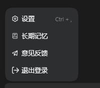
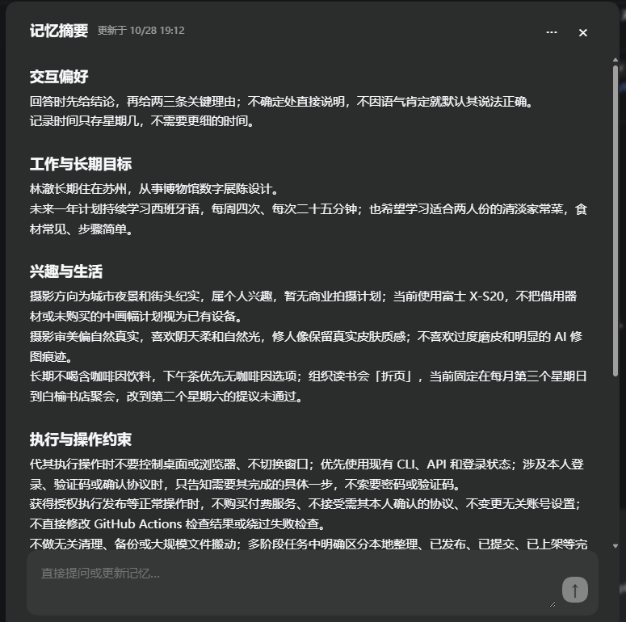
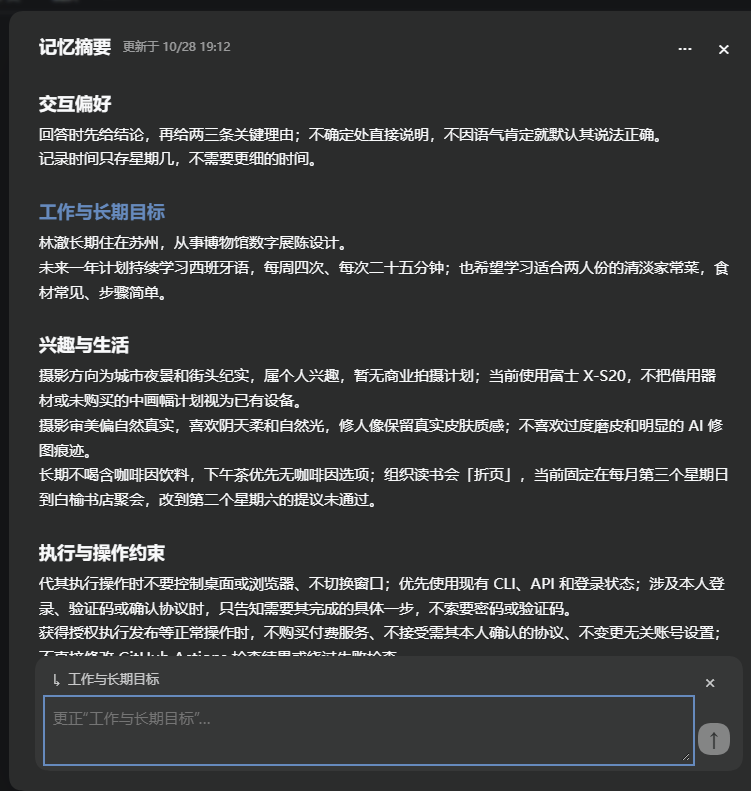
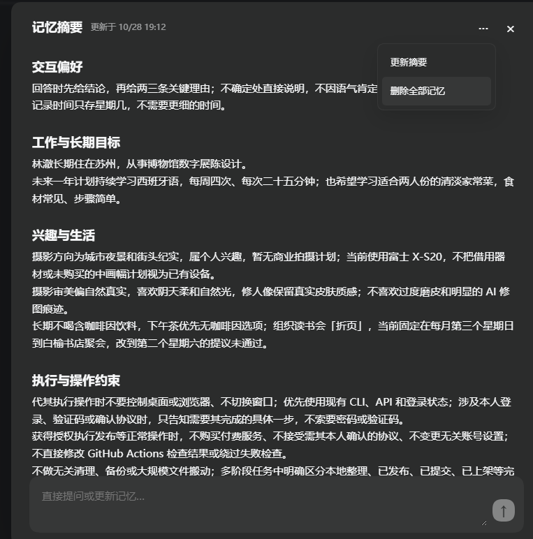

# spike-ltm

**Local long-term memory for DeepSeek Harness** · DeepSeek Harness 的本地长期记忆插件

[English](#english) · [中文](#中文)

---

## English

spike-ltm gives DeepSeek Harness a local memory that survives across conversations. It stores durable facts and preferences in SQLite, extracts new memories in the background, recalls relevant ones before answering, and lets you review or edit everything from the avatar menu.

Current version: **0.2.0-rc.2** (release candidate). Single-user, local-first. Test results are in [docs/VALIDATION.md](docs/VALIDATION.md); they are regression numbers, not a benchmark ranking.

### What it does

- **Automatic extraction** — after a turn ends, a durable job asks the host model what is worth remembering; failures never block the chat.
- **Semantic recall** — a local BGE embedding model runs in a child process; the current session model reviews a small candidate set before injection.
- **Corrections** — a clearly stated new fact replaces the old one through a version-checked write, keeping history.
- **Project scope** — memory is bound to the real workspace directory from the session header, never to a folder name.
- **Reliable forgetting** — deleting removes the entry, versions, sources, vectors, and dependent summary bullets; queued jobs cannot resurrect it.
- **In-app editing** — the avatar menu opens a memory summary; you can discuss a change, preview it, and click Update, or edit directly.

### Install

Requires **Node.js 24** and DeepSeek Harness 0.2.1-rc.3 (other host versions need re-validation).

```sh
npm ci
npm run test:all
npm pack
```

Install `spike-ltm-0.2.0-rc.2.tgz` through Harness's plugin manager.

Market index (add as an index source in Plugins → Discover):

```
https://raw.githubusercontent.com/hcg91/spike-ltm/main/market/index.json
```

Or download the release asset directly:
<https://github.com/hcg91/spike-ltm/releases/tag/v0.2.0-rc.2>

### Privacy

Memory stays in a local SQLite database. Extraction and summary editing send the current utterance, or the selected summary section, to the host model you already use. Embeddings run on your machine. No account credentials, telemetry, or model weights are stored or uploaded. SQLite is not encrypted; protect the profile directory with OS permissions. See [SECURITY.md](SECURITY.md).

### Limitations

- Known synthetic regression sets only; no independent blind evaluation and no peer comparison. Do not read the test counts as accuracy.
- Not validated on Linux or other Harness versions; the desktop UI has not been clicked through end-to-end in CI.
- No automatic migration of an existing JSON store; migration is explicit and backed up. See [docs/MIGRATION.md](docs/MIGRATION.md).
- A single host process may write to one database. Recall and extraction have token and length budgets; very long inputs are not guaranteed to be remembered in full.

### Screenshots

The screenshots below use synthetic demo data in an isolated test profile.

| Entry | Summary | Edit |
|---|---|---|
|  |  |  |

### Tests and contributing

```sh
npm test                 # quick regression
npm run test:all         # storage, jobs, forgetting, host wiring
npm run test:semantic    # real local embeddings and recall wiring
```

Tests use synthetic temporary data. See [CONTRIBUTING.md](CONTRIBUTING.md), [THIRD_PARTY_NOTICES.md](THIRD_PARTY_NOTICES.md) for referenced projects, and [docs/EVALUATION.md](docs/EVALUATION.md) for the evaluation method. MIT licensed.

---

## 中文

spike-ltm 给 DeepSeek Harness 加一份跨对话保存的本地记忆：把值得记的事实和偏好存进 SQLite，在后台提炼，在回答前按语义找回，并且可以在头像菜单里查看和修改。

当前版本：**0.2.0-rc.2**（发布候选）。单人本地使用，测试结果是回归数据，不是准确率排名，见[验收记录](docs/VALIDATION.md)。

### 能做什么

- **自动提炼**：一轮对话结束后，用持久化任务询问宿主模型哪些内容值得记；失败不会打断聊天。
- **语义召回**：本地 BGE 向量模型跑在子进程里；注入前由当前会话模型复核少量候选。
- **事实纠正**：明确说出的新事实通过带版本校验的写入替换旧内容，同时保留历史。
- **项目隔离**：作用域绑定宿主会话里的真实工作目录，不按文件夹名猜项目。
- **可靠遗忘**：删除条目、历史、来源、向量以及依赖它的摘要；已排队的任务不能把它写回来。
- **内置编辑**：头像菜单打开记忆摘要，可以对话提出修改、预览后再点更新，也可以直接编辑。

### 安装

需要 **Node.js 24** 和 DeepSeek Harness 0.2.1-rc.3（其他宿主版本需重新验证接口）。

```sh
npm ci
npm run test:all
npm pack
```

在 Harness 插件管理里安装生成的 `spike-ltm-0.2.0-rc.2.tgz`。

也可以在「插件 → 发现 → 索引源」添加本仓库的市场索引：

```
https://raw.githubusercontent.com/hcg91/spike-ltm/main/market/index.json
```

或直接下载 Release 资产：
<https://github.com/hcg91/spike-ltm/releases/tag/v0.2.0-rc.2>

### 隐私

记忆保存在本地 SQLite 中。提炼和摘要编辑会把当前发言或选中的摘要段落发送给你正在使用的宿主模型；向量在本机计算。不保存账号凭据，不做遥测，也不分发模型权重。SQLite 没有加密，请用系统账户和磁盘权限保护 profile 目录。详见 [SECURITY.md](SECURITY.md)。

### 已知限制

- 只有已知合成回归集，未做独立盲测，也没有和同类项目同场对比，不能把测试数量当成准确率。
- 未验证 Linux 和其他 Harness 版本；桌面界面没有在 CI 里逐项点击验证。
- 不自动迁移旧的 JSON 存储；迁移需要显式执行并保留备份，见[迁移说明](docs/MIGRATION.md)。
- 同一数据库只允许一个宿主进程写入。召回和提炼都有 token 与长度预算，很长的输入不保证全部记住。

### 界面截图

下面的截图使用隔离测试 profile 里的合成演示数据。

| 头像菜单入口 | 记忆摘要 | 选中一段修改 |
|---|---|---|
|  |  |  |

更新摘要与删除入口：



### 测试与贡献

```sh
npm test                 # 快速回归
npm run test:all         # 存储、任务、遗忘、宿主接线
npm run test:semantic    # 真实本地向量与召回接线
```

测试使用合成临时数据。贡献方式见 [CONTRIBUTING.md](CONTRIBUTING.md)，参考项目见 [THIRD_PARTY_NOTICES.md](THIRD_PARTY_NOTICES.md)，评测方法见[评测说明](docs/EVALUATION.md)。MIT 许可证。
